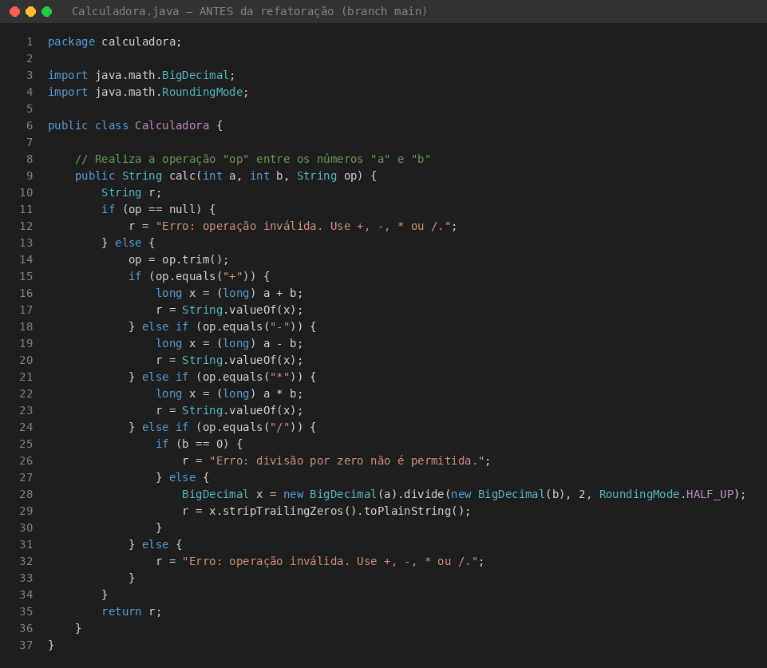
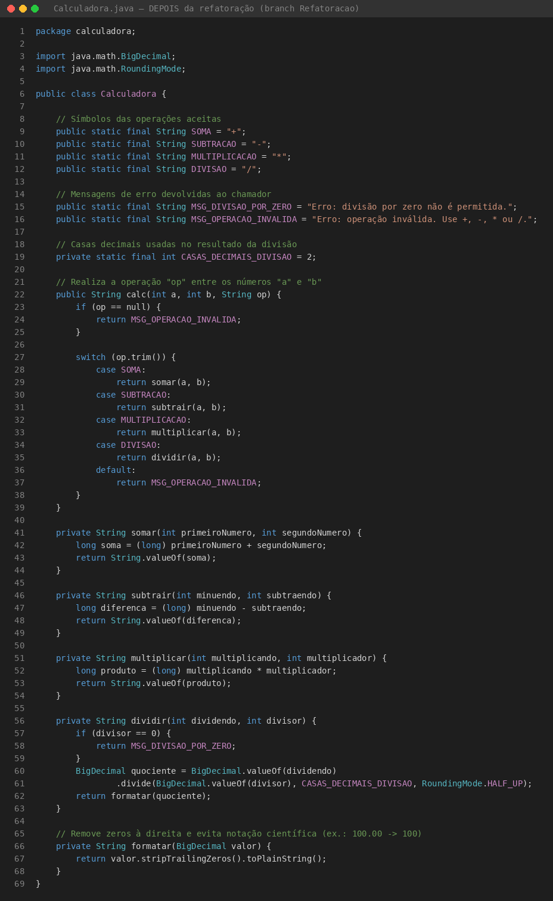
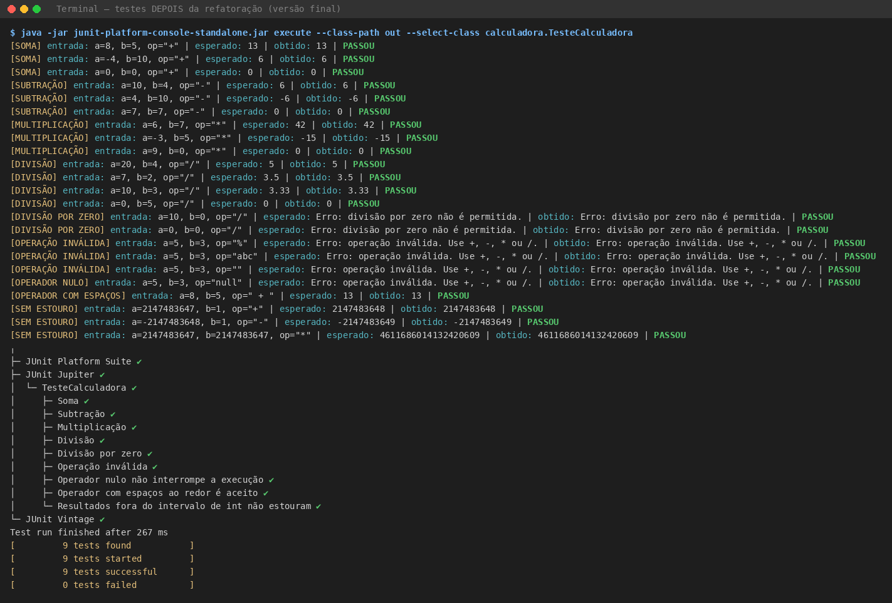
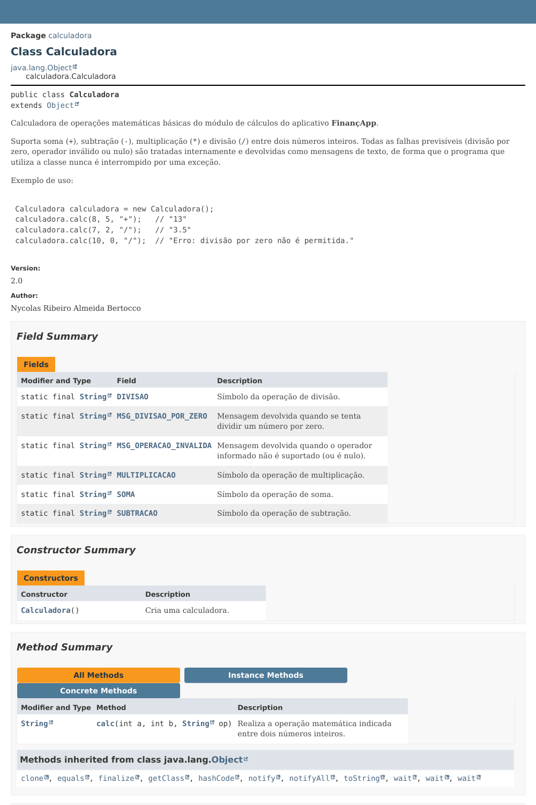
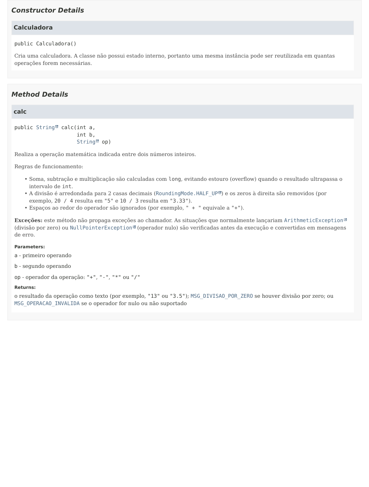

# Projeto Calculadora — FinançApp

> Projeto acadêmico desenvolvido com foco em Qualidade de Software, Testes, Refatoração, Documentação e Versionamento.

---

## 1. Identificação do Projeto

**Projeto:** Projeto Calculadora  
**Contexto:** FinançApp  
**Aluno:** Nycolas Ribeiro Almeida Bertocco  
**RA:** 251191  
**Curso:** Análise e Desenvolvimento de Sistemas  
**Disciplina:** UX/UI e Testes de Software  
**Professor:** Daniel Ohata  
**Semestre:** 2026.2  
**Repositório:** [github.com/nybertocco/projeto_calculadora](https://github.com/nybertocco/projeto_calculadora)

---

# 2. Visão Geral

O projeto consiste no desenvolvimento de um módulo de cálculos matemáticos básicos em Java para a startup fictícia **FinançApp**.

O módulo foi desenvolvido com o objetivo de ser utilizado futuramente em funcionalidades de controle financeiro, como:

- orçamento mensal;
- divisão de despesas;
- projeções financeiras;
- cálculos auxiliares.

Além do funcionamento correto das operações, o projeto aplica práticas de qualidade de software relacionadas a:

- testes;
- tratamento de erros;
- refatoração;
- documentação;
- versionamento;
- manutenção de código.

---

# 3. Problema

Durante o desenvolvimento da aplicação FinançApp, foi identificada a necessidade de criar um módulo matemático reutilizável.

Entretanto, a equipe definiu que o módulo não deveria apenas funcionar corretamente, mas também apresentar:

- código legível;
- testes automatizados;
- tratamento de falhas;
- documentação técnica;
- controle de versões;
- facilidade de manutenção.

O desafio consiste, portanto, em desenvolver uma solução funcional e ao mesmo tempo aplicar boas práticas de Engenharia de Software.

---

# 4. Objetivo

## 4.1 Objetivo Geral

Desenvolver uma calculadora em Java aplicando práticas de qualidade, testes, documentação, refatoração e versionamento.

## 4.2 Objetivos Técnicos

- implementar operações matemáticas básicas;
- tratar entradas inválidas;
- impedir divisão por zero;
- desenvolver testes automatizados;
- refatorar o código sem alterar seu comportamento;
- documentar classes e métodos com JavaDoc;
- gerar documentação HTML;
- utilizar Git e GitHub;
- organizar commits e branches;
- manter documentação técnica no README.

---

# 5. Escopo Funcional

A aplicação oferece as seguintes operações:

| ID   | Funcionalidade       | Descrição                        | Status |
| ---- | -------------------- | -------------------------------- | ------ |
| RF01 | Soma                 | Soma dois números inteiros       | ✅     |
| RF02 | Subtração            | Subtrai dois números inteiros    | ✅     |
| RF03 | Multiplicação        | Multiplica dois números inteiros | ✅     |
| RF04 | Divisão              | Divide dois números inteiros     | ✅     |
| RF05 | Validação de divisão | Impede divisão por zero          | ✅     |
| RF06 | Operação inválida    | Trata operadores não suportados  | ✅     |

---

# 6. Requisitos Não Funcionais

| ID    | Categoria      | Requisito                                                  |
| ----- | -------------- | ---------------------------------------------------------- |
| RNF01 | Qualidade      | O código deve possuir organização e legibilidade           |
| RNF02 | Testabilidade  | As operações devem possuir testes automatizados            |
| RNF03 | Manutenção     | O código deve permitir refatoração sem alteração funcional |
| RNF04 | Documentação   | Classes e métodos devem possuir JavaDoc                    |
| RNF05 | Versionamento  | O projeto deve utilizar Git e GitHub                       |
| RNF06 | Confiabilidade | Erros não devem interromper inesperadamente a execução     |

---

# 7. Tecnologias Utilizadas

| Tecnologia | Versão                                          | Utilização                                                                        |
| ---------- | ----------------------------------------------- | --------------------------------------------------------------------------------- |
| Java       | 21 (compatível com 17+)                         | Desenvolvimento                                                                   |
| JDK        | OpenJDK 21                                      | Compilação                                                                        |
| JUnit      | 5 (Jupiter)                                     | Testes                                                                            |
| Git        | 2.43                                            | Controle de versão                                                                |
| GitHub     | —                                               | Repositório remoto                                                                |
| JavaDoc    | — (JDK 21)                                      | Documentação                                                                      |
| IDE        | Linha de comando (JDK + JUnit Console Launcher) | Ambiente de desenvolvimento. O projeto também abre em Eclipse, IntelliJ e VS Code |

---

# 8. Estrutura do Projeto

```text
projeto_calculadora/
│
├── src/
│   └── calculadora/
│       └── Calculadora.java
│
├── test/
│   └── calculadora/
│       └── TesteCalculadora.java
│
├── docs/
│   └── index.html            (e demais arquivos gerados pelo JavaDoc)
│
├── images/
│   ├── testes/
│   ├── javadoc/
│   └── refatoracao/
│
├── README.md
├── .gitignore
└── pom.xml
```

---

# 9. Explicação das Operações

O método `calc(int a, int b, String op)` recebe dois números inteiros e o operador, e devolve um `String` com o resultado **ou** uma mensagem de erro. Ele nunca lança exceção para quem o chamou.

| Operador        | Operação          | Exemplo            | Resultado                                    |
| --------------- | ----------------- | ------------------ | -------------------------------------------- |
| `+`             | Soma              | `calc(8, 5, "+")`  | `13`                                         |
| `-`             | Subtração         | `calc(4, 10, "-")` | `-6`                                         |
| `*`             | Multiplicação     | `calc(6, 7, "*")`  | `42`                                         |
| `/`             | Divisão           | `calc(7, 2, "/")`  | `3.5`                                        |
| `/`             | Divisão por zero  | `calc(10, 0, "/")` | `Erro: divisão por zero não é permitida.`    |
| outro ou `null` | Operação inválida | `calc(5, 3, "%")`  | `Erro: operação inválida. Use +, -, * ou /.` |

**Decisões de projeto**

- **Divisão com casas decimais:** o resultado é arredondado para 2 casas (`HALF_UP`) e os zeros à direita são removidos: `20 / 4` → `5` e `10 / 3` → `3.33`. Como o app é financeiro, a divisão inteira (`10 / 3 = 3`) perderia informação.
- **Sem estouro de `int`:** soma, subtração e multiplicação são calculadas com `long` (ex.: `Integer.MAX_VALUE + 1` → `2147483648`).
- **Sem exceções para o chamador:** a divisão por zero e o operador `null` são verificados _antes_ da conta, evitando `ArithmeticException` e `NullPointerException`. Espaços ao redor do operador são ignorados (`" + "` equivale a `"+"`).

---

# 10. Testes Unitários

A classe `TesteCalculadora` (JUnit 5) cobre os seis cenários obrigatórios e três testes complementares de robustez. **Cada teste imprime a entrada utilizada, o resultado esperado e o resultado obtido.**

| Teste                          | Entrada (a, b, op)          | Esperado                                     |
| ------------------------------ | --------------------------- | -------------------------------------------- |
| Soma                           | 8, 5, `+`                   | `13`                                         |
| Subtração                      | 4, 10, `-`                  | `-6`                                         |
| Multiplicação                  | 6, 7, `*`                   | `42`                                         |
| Divisão                        | 7, 2, `/`                   | `3.5`                                        |
| Divisão por zero               | 10, 0, `/`                  | `Erro: divisão por zero não é permitida.`    |
| Operação inválida              | 5, 3, `%`                   | `Erro: operação inválida. Use +, -, * ou /.` |
| Operador nulo _(extra)_        | 5, 3, `null`                | `Erro: operação inválida. Use +, -, * ou /.` |
| Espaços no operador _(extra)_  | 8, 5, `+`                   | `13`                                         |
| Sem estouro de `int` _(extra)_ | `Integer.MAX_VALUE`, 1, `+` | `2147483648`                                 |

Cada teste executa mais de uma entrada (por exemplo, a soma é verificada com positivos, com um número negativo e com zeros), totalizando 23 verificações.

### Execução dos testes — antes da refatoração (branch `main`, commit `5b9c083`)


---

# 11. Refatoração

A refatoração foi feita na branch **`Refatoracao`**, em dois commits, sem alterar o comportamento nem os testes.

| Técnica aplicada              | Antes                                 | Depois                                                                                                                     |
| ----------------------------- | ------------------------------------- | -------------------------------------------------------------------------------------------------------------------------- |
| Extração de métodos           | Toda a lógica dentro de `calc`        | Um método privado por operação (`somar`, `subtrair`, `multiplicar`, `dividir`) e `formatar`                                |
| Simplificação de condicionais | `if / else` aninhado em vários níveis | `switch` com retornos diretos                                                                                              |
| Constantes                    | Textos e símbolos repetidos no código | `SOMA`, `SUBTRACAO`, `MULTIPLICACAO`, `DIVISAO`, `MSG_DIVISAO_POR_ZERO`, `MSG_OPERACAO_INVALIDA`, `CASAS_DECIMAIS_DIVISAO` |
| Nomes de variáveis            | `r`, `x`                              | `soma`, `diferenca`, `produto`, `quociente`, `dividendo`, `divisor`                                                        |

A assinatura pública exigida pelo enunciado foi mantida: `calc(int a, int b, String op)`.

### Código antes da refatoração



### Código depois da refatoração



### Execução dos testes — depois da refatoração



Os mesmos 9 testes, **sem nenhuma alteração**, passam antes e depois da refatoração, comprovando que o comportamento do sistema foi preservado.

---

# 12. Documentação JavaDoc

Todas as classes, atributos, métodos, parâmetros, retornos e o comportamento diante de exceções estão documentados (`@author`, `@version`, `@param`, `@return`). A documentação HTML fica em `docs/`; **abra `docs/index.html` no navegador** (o GitHub exibe apenas o código-fonte do HTML).





Para gerar novamente a documentação (a partir da raiz do projeto):

```bash
javadoc -Xdoclint:all -d docs -sourcepath src -encoding UTF-8 -docencoding UTF-8 -charset UTF-8 \
        -author -version calculadora
```

---

# 13. Versionamento

| Branch        | Conteúdo                                                                                           |
| ------------- | -------------------------------------------------------------------------------------------------- |
| `main`        | Branch principal: implementação, testes e, após o merge, a versão refatorada com JavaDoc e `docs/` |
| `Refatoracao` | Refatoração do código, comentários, JavaDoc e geração do `docs/`                                   |

Histórico de commits (`git log --oneline --graph --all`, até o merge):

```text
*   c3743a9 Merge da branch Refatoracao na main (refatoração + JavaDoc + docs/)
|\
| * 2566d09 docs: gera a documentação JavaDoc em docs/ (index.html) e documenta o construtor
| * 2e4af50 docs: adiciona comentários técnicos e JavaDoc completo (@author, @version, @param, @return)
| * bfba5cf refactor: cria constantes para operadores e mensagens, troca if/else por switch...
| * b7d15e6 refactor: extrai um método privado para cada operação e reduz o aninhamento
|/
* 5b9c083 test: adiciona TesteCalculadora (soma, subtração, multiplicação, divisão, ...)
* 507d929 feat: trata divisão por zero, operação inválida e operador nulo
* 043f564 feat: implementa classe Calculadora com soma, subtração, multiplicação e divisão
* 60a15ea chore: cria estrutura inicial do projeto_calculadora
```

---

# 14. Como Executar

**Pré-requisitos:** JDK 17 ou superior (e Maven, para usar a linha de comando).

```bash
# 1. Clonar o repositório
git clone https://github.com/nybertocco/projeto_calculadora.git
cd projeto_calculadora

# 2. Rodar os testes (Maven)
mvn test
```

Também é possível abrir a pasta em uma IDE (Eclipse, IntelliJ ou VS Code), marcar `src` como pasta de código e `test` como pasta de testes, adicionar o JUnit 5 e executar a classe `TesteCalculadora`.

---

# 15. Link do Repositório

**GitHub:** https://github.com/nybertocco/projeto_calculadora

Branches: `main` e `Refatoracao`.
